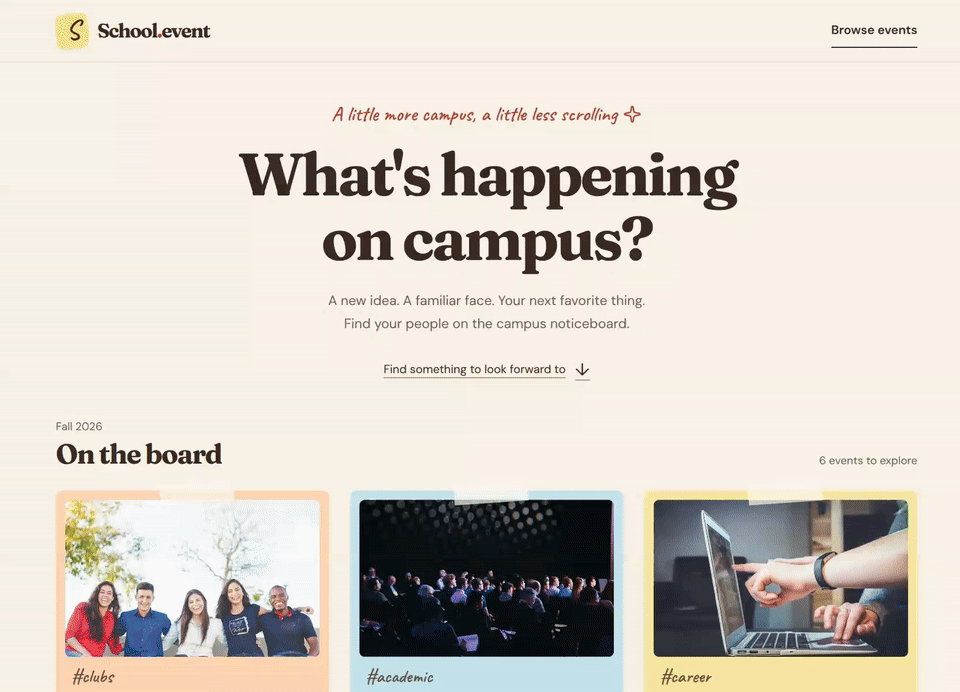

# Milestone 3 Progress Report

## GitHub Project Setup

Project board created: yes

Project board shared with codepathreview: yes

Project board: [WEB103-Final-Project](https://github.com/orgs/web103-final-project/projects/1).

The private board is linked to this repository. The grading account **codepathreview** received Reader access through the project's collaborator settings, separately from repository access.

Issues #1, #2, #5, and #9 through #14 have status **Todo** for later milestones. Initial browsing/details issues #3 and #4, planning issues #6 and #7, and project-management issue #8 have status **Done**.

## Issues Created

List the title of each issue you created, one per line:

- [Create event page #1](https://github.com/web103-final-project/school.Event/issues/1)
- [Edit event page #2](https://github.com/web103-final-project/school.Event/issues/2)
- [Create home page 1 #3](https://github.com/web103-final-project/school.Event/issues/3)
- [View event details #4](https://github.com/web103-final-project/school.Event/issues/4)
- [RSVP to events #5](https://github.com/web103-final-project/school.Event/issues/5)

The following issues also record planning and project-management work:

- [Complete project definition and user stories #6](https://github.com/web103-final-project/school.Event/issues/6)
- [Complete wireframes and database design #7](https://github.com/web103-final-project/school.Event/issues/7)
- [Complete Milestone 3 project management #8](https://github.com/web103-final-project/school.Event/issues/8)

Additional planned work is also tracked on the board:

- [Add PostgreSQL persistence and database reset #9](https://github.com/web103-final-project/school.Event/issues/9)
- [Delete events #10](https://github.com/web103-final-project/school.Event/issues/10)
- [Filter events by category and sort by date #11](https://github.com/web103-final-project/school.Event/issues/11)
- [Validate event submissions before database writes #12](https://github.com/web103-final-project/school.Event/issues/12)
- [Deploy to Render and verify the complete app #13](https://github.com/web103-final-project/school.Event/issues/13)
- [Prepare final walkthrough and submission documentation #14](https://github.com/web103-final-project/school.Event/issues/14)

These issues are open and are not counted as completed Unit 7 work.

## GitHub Milestones Created

List the name of each GitHub Milestone you created, one per line:

- [Milestone 1 - Unit 5](https://github.com/web103-final-project/school.Event/milestone/4)
- [Milestone 2 - Unit 6](https://github.com/web103-final-project/school.Event/milestone/5)
- [Milestone 3 - Unit 7](https://github.com/web103-final-project/school.Event/milestone/1)
- [Milestone 4 - Unit 8](https://github.com/web103-final-project/school.Event/milestone/2)
- [Final Milestone - Unit 9](https://github.com/web103-final-project/school.Event/milestone/3)

## Milestone 3 Completion

Completion percentage for Milestone 3 - Unit 7: 100%

Milestone 3 contains three completed issues and no open issues. The initial frontend and basic Express backend use sample data. PostgreSQL persistence and write operations remain planned. Milestone 4 contains issues #1, #2, and #9 through #12. The final milestone contains issues #5, #13, and #14.

List each issue you completed this unit and the main file or folder where that work lives, one per line:

- [Create home page 1 #3](https://github.com/web103-final-project/school.Event/issues/3) - [client/src/pages/Home.jsx](../client/src/pages/Home.jsx), [client/src/components/EventCard.jsx](../client/src/components/EventCard.jsx), and [server/app.js](../server/app.js).
- [View event details #4](https://github.com/web103-final-project/school.Event/issues/4) - [client/src/pages/EventDetails.jsx](../client/src/pages/EventDetails.jsx), [client/src/components/EventMeta.jsx](../client/src/components/EventMeta.jsx), and [client/src/api.js](../client/src/api.js).
- [Complete Milestone 3 project management #8](https://github.com/web103-final-project/school.Event/issues/8) - [milestones/milestone3.md](milestone3.md), [milestones/progress_report_3.md](progress_report_3.md), and [README.md](../README.md). The board, issue statuses, milestone assignments, and grader access live in GitHub.

Issues #6 and #7 record completed Unit 5 and Unit 6 planning deliverables. They are not application features completed during Unit 7.

## Features Completed This Unit

- ✅ Browse school events using the sample Express event API.
- ✅ View read-only event details through a dynamic frontend route.

Both features are checked in [README.md](../README.md) and demonstrated in this GIF:

Verification passed for all five API tests and the production frontend build. Browser checks covered desktop and mobile layouts, keyboard navigation, direct URL reloads, loading, empty results, missing events, and recovery after a request failure.

Implementation, documentation, and GIF evidence are included on `milestone-3-kavya` for review and submission. No database, event write operations, filtering, or RSVP behavior is claimed as complete.
